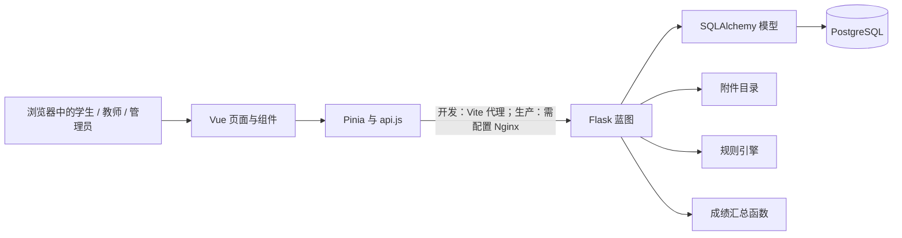
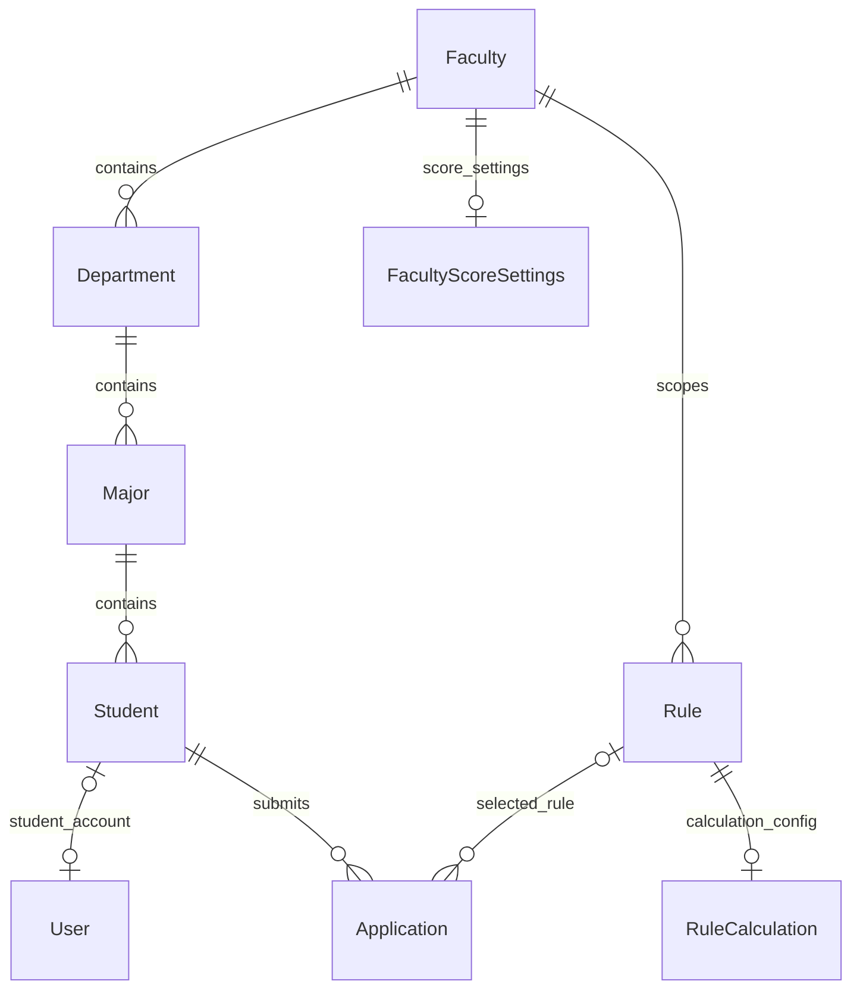
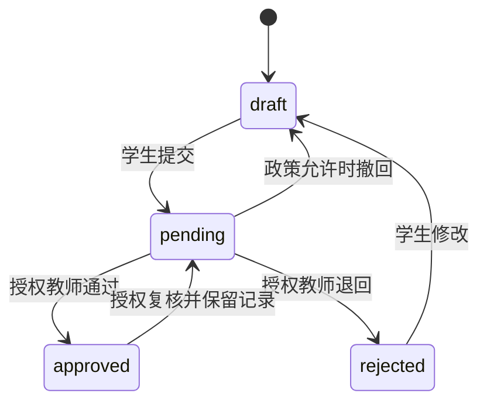

# GradPush 源码阅读笔记与本学期交付路线

阅读日期：2026 年 9 月 10 日  
阅读对象：当前本地 GradPush 项目  
适用目标：接手旧项目，在本学期完成可试点、可部署、可维护的推免成绩与申报管理平台。

## 1. 先认识这个项目

**GradPush 已有较完整的业务界面和基础数据模型，适合继续迭代；但目前不能直接作为正式推免成绩依据投入使用。** 最需要补齐的是后端权限、统一计分、年度隔离、审核留痕和部署验证，而不是继续堆页面。

从源码看，它更准确的定位是“推免加分申报、审核和综合成绩管理系统”：学生选规则、上传材料、申报加分；教师核定分数；管理员维护组织、人员、规则和学业成绩；平台汇总并导出结果。

它尚不是完整的“课程绩点计算器”。当前 `Student.gpa` 和 `Student.academic_score` 是独立保存、可直接编辑的结果字段，未见课程、学分、选课成绩、重修记录等模型，也未见由课程明细统一计算 GPA 的业务链路。这里的“学业成绩”“学术专长”“综合成绩”必须区分。

建议本学期先交付一个明确范围：**一个学院、一个推免年度的完整业务闭环，同时在数据结构上支持多学院和多年度。** 是否加入课程级绩点计算，应先向使用方确认；不能把项目现有的字段名称当成已经实现的能力。

### 阅读与验证边界

- 深读了前后端入口、路由与状态管理、数据模型、认证、申请、审核、规则引擎和成绩汇总；检查了管理、组织导入、文件与运维接口的关键实现。
- 检查了 39 个数据库迁移文件的版本依赖关系，没有逐个在数据库上执行迁移。
- 完成现有依赖环境下的前端生产构建、59 个 Python 文件的语法解析，以及独立规则引擎样例检查。
- 没有连接现有 PostgreSQL，没有读取数据库中的学生信息，没有执行初始化、备份恢复或修改真实业务数据。没有做浏览器端到端验收或生产服务器审计。
- 下文“已确认”指当前源码明确表现出的行为；对运行时故障、性能和部署恢复能力另列验证要求。代码问题不代表已经发生过真实安全事件。

## 2. 项目地图：文件分别负责什么

```text
GradPush/
├─ frontend/
│  ├─ main.js / App.vue          前端启动、全局组件、页面容器
│  ├─ router/index.js            登录、学生、教师、管理员路由
│  ├─ views/                    三个角色的工作台和登录页
│  ├─ stores/                   登录状态、申请数据、文件和提示消息
│  ├─ utils/api.js              fetch 封装、接口路径、文件 URL
│  ├─ components/student/       申报、历史记录、个人统计
│  ├─ components/teacher/       待审核、审核历史
│  ├─ components/admin/         用户、规则、成绩、组织、文件、系统设置
│  ├─ components/common/        审核详情、统计报表、资料和公共布局
│  └─ vite.config.js            开发代理和构建配置
├─ backend/
│  ├─ app.py                    Flask 初始化、蓝图注册、文件服务
│  ├─ config.py / extensions.py  配置、数据库、Session 扩展
│  ├─ models.py                 SQLAlchemy 数据模型
│  ├─ blueprints/               按业务划分的 HTTP 接口
│  ├─ utils/rule_engine.py      树形规则分值计算
│  ├─ utils/captcha.py          图片验证码
│  ├─ migrations/               Alembic 数据库版本变更
│  ├─ init_db.py                建表、演示基础数据初始化
│  ├─ db_backup.py              数据库与附件备份恢复
│  └─ instance/、backup/、logs/  本地数据库文件、备份、运行日志
├─ README.md                    快速启动说明，部分内容已过时
├─ Problems.md                  原作者遗留问题清单
└─ 部署指南.md / 宝塔网站配置.md  部署参考，不能直接作为验收依据
```

`node_modules`、`venv`、`dist`、缓存、日志和备份不是业务源码。阅读时应排除；发布时按用途管理，避免把本地数据和运行环境一起交付。

### 技术栈与理解方式

| 层次 | 当前实现 | 阅读重点 |
| --- | --- | --- |
| 页面 | Vue 3 单文件组件 | 模板、响应式数据、事件和接口调用之间的关系 |
| 路由 | Vue Router 4 | `meta.role` 控制页面入口，不等于服务端权限 |
| 状态 | Pinia 3 | 登录状态、申请列表、加载和错误状态 |
| 构建 | Vite 7 | 开发代理与生产 Nginx 是两套配置 |
| 报表 | SheetJS / `xlsx` | 浏览器端生成 Excel，数据来自排名接口 |
| HTTP 服务 | Flask 3 | 蓝图是接口模块，尚未充分分离业务服务层 |
| 数据访问 | SQLAlchemy 2、Flask-SQLAlchemy | 模型、查询、事务与关系 |
| 数据库 | 当前配置为 PostgreSQL | 本地存在 SQLite 文件不代表运行时使用它 |
| 认证 | Flask-Session 文件会话、bcrypt | 服务器会话是真实身份来源，bcrypt 用于密码哈希 |
| 迁移 | Flask-Migrate / Alembic | 代码模型和数据库结构必须同步升级 |

前端包要求 Node `^20.19.0 || >=22.12.0`。后端依赖固定了版本，但包含开发及其他用途依赖，后续宜拆分运行依赖和开发依赖。不要依赖拷贝旧 `venv` 来部署到另一台机器。

## 3. 推荐的源码阅读顺序

| 顺序 | 入口 | 阅读后应能回答的问题 |
| --- | --- | --- |
| 1 | [前端入口](D:/jiaohusheji/无所谓队/最终项目/GradPush/frontend/main.js)、[路由](D:/jiaohusheji/无所谓队/最终项目/GradPush/frontend/router/index.js) | 页面如何启动？不同身份进入哪里？ |
| 2 | [后端入口](D:/jiaohusheji/无所谓队/最终项目/GradPush/backend/app.py)、[配置](D:/jiaohusheji/无所谓队/最终项目/GradPush/backend/config.py) | 接口地址如何拼接？连接什么数据库？附件保存在哪里？ |
| 3 | [数据模型](D:/jiaohusheji/无所谓队/最终项目/GradPush/backend/models.py) | 用户、学生、申请、规则、成绩怎样关联？ |
| 4 | [登录状态](D:/jiaohusheji/无所谓队/最终项目/GradPush/frontend/stores/auth.js)、[认证接口](D:/jiaohusheji/无所谓队/最终项目/GradPush/backend/blueprints/auth_bp.py) | 登录后保存了什么？服务器如何辨认访问者？ |
| 5 | [申请表](D:/jiaohusheji/无所谓队/最终项目/GradPush/frontend/components/student/ApplicationForm.vue)、[申请 Store](D:/jiaohusheji/无所谓队/最终项目/GradPush/frontend/stores/applications.js) | 表单如何变成 JSON 与附件请求？ |
| 6 | [申请接口](D:/jiaohusheji/无所谓队/最终项目/GradPush/backend/blueprints/application_bp.py) | 创建、编辑、审核、删除各自改了哪些表？ |
| 7 | [规则编辑](D:/jiaohusheji/无所谓队/最终项目/GradPush/frontend/components/admin/RuleModal.vue)、[规则引擎](D:/jiaohusheji/无所谓队/最终项目/GradPush/backend/utils/rule_engine.py) | 规则树如何保存？学生选择的路径如何得到分数？ |
| 8 | [成绩接口](D:/jiaohusheji/无所谓队/最终项目/GradPush/backend/blueprints/score_bp.py)、[统计报表](D:/jiaohusheji/无所谓队/最终项目/GradPush/frontend/components/common/StatisticsReport.vue) | 核定分如何汇总？排名和导出如何产生？ |
| 9 | [维护接口](D:/jiaohusheji/无所谓队/最终项目/GradPush/backend/blueprints/system_bp.py)、[初始化脚本](D:/jiaohusheji/无所谓队/最终项目/GradPush/backend/init_db.py) | 如何安装、迁移、备份、恢复？是否会影响已有数据？ |

不要一开始逐行读完大型 Vue 文件。先找 `<script>`、`import`、提交函数、API 调用，再回看触发它们的模板，最后看样式。当前申请表约 1755 行，审核详情约 1600 行，其中包含大量样式与兼容代码。

## 4. 前后端如何串起来



### 4.1 前端启动和身份

`main.js` 创建 Vue、Router、Pinia，注册图标与全局样式；在 `DOMContentLoaded` 回调里调用 `authStore.initialize()`，随后加载申请列表并挂载页面。

`auth.js` 将用户展示信息保存在 `localStorage`，初始化时再调用 `/api/session-check` 验证会话，并尝试拉取当前用户。路由守卫根据 `isAuthenticated` 和 `role` 决定是否进入工作台。

需要理解两个边界：浏览器本地信息可被用户修改；前端守卫只能控制界面跳转。每个后端接口仍须独立核验登录身份、角色和数据归属。目前 `main.js` 还会在未登录状态加载申请列表，补齐权限后应调整成登录成功后按身份加载。

### 4.2 接口与数据格式

`api.js` 以 `/api` 为统一前缀，使用 `fetch`，设置 `credentials: 'include'` 携带 Cookie，并用 `AbortController` 设置默认 10 秒超时。

前端多使用 `studentId`、`dynamicCoefficients` 等驼峰字段，后端模型使用 `student_id`、`dynamic_coefficients`。申请 Store 和后端接口中都有字段映射，历史兼容分支较多。后续建议定义统一请求和响应结构，在接口边界转换一次。

后端错误响应混用 `message`、`error`、`details`，部分接口又套 `code/data`；前端主要读取 `responseData.message`。这会让具体校验错误退化成“请求失败”。应统一错误格式，并处理 401、403、非 JSON 错误页和上传超时。

### 4.3 常用实际接口导航

| 用途 | HTTP 接口 | 后端文件 |
| --- | --- | --- |
| 登录、注册、重置 | `POST /api/login`、`/api/register`、`/api/reset-password` | `auth_bp.py` |
| 当前身份 | `GET /api/session-check`、`GET /api/user/current` | `auth_bp.py`、`user_bp.py` |
| 申请增删改查 | `/api/applications`、`/api/applications/{id}` | `application_bp.py` |
| 审核 | `POST /api/applications/{id}/review` | `application_bp.py` |
| 规则及计算配置 | `/api/rules`、`/api/rules/{id}/calculation` | `rule_bp.py` |
| 分数预估 | `POST /api/rules/{id}/calculate` | `rule_bp.py` |
| 学生与排名 | `/api/students`、`/api/students/ranking`、`/api/students/statistics` | `score_bp.py` |
| 学院计分设置 | `/api/admin/faculty-score-settings/{faculty_id}` | `admin_bp.py` |
| 公开系统信息 | `GET /api/public/system-info` | `public_bp.py` |
| 备份与恢复 | `/api/system/backup`、`/api/system/restore` | `system_bp.py` |
| 健康检查 | `GET /api/health` | `routes.py` |

这是导航表，不是完整接口契约。接口名含 `admin`，或函数注释写“仅管理员”，都不代表实际已鉴权。

## 5. 数据模型：理解业务的骨架



图展示业务关系；`RuleCalculation` 的一对一是 ORM 声明的意图，当前 `rule_id` 字段本身未声明唯一约束，应补数据库约束，防止并发产生多条配置。

| 模型 | 关键含义 | 接手时注意 |
| --- | --- | --- |
| `User` | 账号、bcrypt 密码、角色、状态、联系方式 | 教师和管理员不一定关联学生；不能允许公开注册高权限角色 |
| `Student` | 学号、组织归属、四六级、GPA、学业分、汇总分 | 既放基础信息又放计算结果，需明确权威来源 |
| `Application` | 申报项目、自评分、附件 JSON、动态系数、审核结果 | 只保存当前审核结果，缺少多次审核记录和年度关联 |
| `Rule` | 规则分类、基础分、项目数量上限、分数上限、学院 | 与计算配置存在重复字段，容易出现不同步 |
| `RuleCalculation` | `calculation_type`、参数 JSON、最大分数、精度 | 当前引擎只真正支持 `tree`，不是注释中的所有类型 |
| `FacultyScoreSettings` | 学业权重、学术专长上限、综合表现上限 | 默认值为 80%、15 分、5 分 |
| `SystemSettings` | 学年文字、申报时间、文件限制、维护状态 | 学年文字不是年度数据隔离机制 |
| `GraduateFile` | 推免通知等资料的文件信息和学院 | 应与学生私密证明附件采用不同访问策略 |
| `Captcha` | 图片验证码、token、过期时间、用户标识 | 图片验证码只能验证交互，不证明账号所有权 |

特别容易混淆的标识：

- `User.id`：内部用户主键。
- `User.username`：登录名；当前学生注册时又被当成学号。
- `Student.id`：内部学生主键；`PUT /api/students/{student_id}` 实际使用它。
- `Student.student_id`：字符串学号；申请关联及个人统计查询使用它。

建议以后把接口变量分别命名为 `student_pk` 与 `student_number`，或明确统一为内部主键。修改账号不能只改 `username`，还需决定学号是否可变、关联数据如何维护。

`User` 与 `Student` 会通过 SQLAlchemy 保存事件同步姓名和组织字段。这个设计减少了手动同步，却增加了隐藏写入和事务复杂度；应在独立数据库中验证，再逐步改为显式业务服务维护。

## 6. 沿着一次申报读代码

### 6.1 管理员配置规则

`RuleManagement.vue` 管理规则列表，`RuleModal.vue` 与 `TreeNode.vue` 编辑树。`prepareCalculationData()` 将计算类型固定为 `tree`，把树保存在 `parameters.tree.structure`。

规则模型同时存在 `Rule.calculation_formula`、`Rule.score/max_score/max_count` 与 `RuleCalculation.parameters/max_score` 等字段。不是每个字段都参与当前计分；阅读应以实际调用链为准。

### 6.2 学生选择条件并预估

关键函数：[calculateEstimatedScore](D:/jiaohusheji/无所谓队/最终项目/GradPush/frontend/components/student/ApplicationForm.vue:844)。

1. 依据选中规则确定申请类型。
2. 把动态表单中带数字索引的树字段排序，转成 `tree_path` 数组。
3. 请求规则计算接口，提交 `{ student_data: { tree_path: [...] } }`。
4. 后端沿规则树按节点名称匹配，取得节点分数，应用 `RuleCalculation.max_score`，保留四位小数。
5. 如果接口失败，前端回退到自己的计算函数。

例如某条配置为“国家级 → 一等奖 → 6 分”，单项上限为 4，匹配后返回 4。这里是示例配置，不能作为任何学院的真实推免政策。

当前树路径按名称匹配并忽略空格；重命名节点会影响历史路径解释。更稳定的做法是保存节点 ID 和规则版本，并同时保留提交时的名称快照。

### 6.3 保存草稿或提交

`ApplicationForm.vue` 组织申报数据，`applications.js:addApplication()` 转字段名，用 `FormData` 携带 `application` JSON 字符串及多份 `files`。

后端 [create_application](D:/jiaohusheji/无所谓队/最终项目/GradPush/backend/blueprints/application_bp.py:334) 校验部分输入及文件扩展名、单文件大小、请求内总大小，生成文件名并落盘，然后保存 `Application`。动态系数作为 JSON 保存，状态默认 `pending`，但目前也接受请求传入的状态。

应补的边界：学生身份必须来自会话；学院和专业来自其档案；只能创建允许的草稿或待审核状态；所选规则必须属于可用年度和学院；截止时间应由后端检查；文件失败要清理已落盘临时文件。

### 6.4 教师审核

教师待审核列表打开 `ApplicationDetailModal.vue`，确认分数和意见后，经 Store 调用 [review_application](D:/jiaohusheji/无所谓队/最终项目/GradPush/backend/blueprints/application_bp.py:815)。

当前行为是：**有 `finalScore` 就优先采用教师传入的分数，并夹在 0～100 之间；没有传入分数才进入另一套自动计算分支。** 审核人也由请求提供。保存审核结果后，再调用 `update_student_statistics()` 汇总。

这说明预估接口里的树形引擎并未成为审核计分的统一入口。不能因为学生端能正确预估，就推断最终成绩一定按照同一规则产生。

### 6.5 汇总与排名

核心函数：[update_student_statistics](D:/jiaohusheji/无所谓队/最终项目/GradPush/backend/blueprints/score_bp.py:30)。

当前公式可写成：

```text
A = min(该学生已通过的 academic 申请 final_score 之和, 学院学术专长上限)
C = min(该学生已通过的 comprehensive 申请 final_score 之和, 学院综合表现上限)
综合成绩 = round(学业成绩 × 学业权重 / 100 + A + C, 4)
```

默认设置下，学业成绩 90、核定学术专长 12、综合表现 4，综合成绩为 `90 × 0.8 + 12 + 4 = 88`。

注意：15 和 5 是加分上限，不是再对原始加分乘 15% 与 5%。`Student` 部分注释仍写 12% 和 8%，与当前设置和运行逻辑不一致。

`get_students_ranking()` 按专业分组、按综合成绩排序，并采用竞赛排名：例如同分时为 1、1、3。报表数据另有全局显示序号，不能把它当成专业名次。当前查询按学生逐个读取两类申请，数据增长后有 N+1 查询压力。

## 7. 已确认的关键问题与修复方向

优先级含义：P0 是接入真实用户和真实材料前必须修复；P1 是正式结果可信、可复核所必需；P2 是试点体验与维护质量。下面基于源码，不是已完成的渗透测试报告。

### 7.1 P0：服务器权限没有形成统一边界

| 已确认的源码行为 | 影响 | 建议 |
| --- | --- | --- |
| `application_bp.py` 的列表、详情、创建、修改、审核、删除没有会话鉴权；应用入口未发现统一认证拦截 | 能绕过页面入口直接访问业务接口；学院筛选只是请求参数 | 统一会话认证、角色授权、本人或学院范围校验；查询默认收窄范围 |
| [register](D:/jiaohusheji/无所谓队/最终项目/GradPush/backend/blueprints/auth_bp.py:284) 直接使用请求中的 `role` 创建用户 | 图片验证码通过后可申请高权限身份 | 公开入口只允许受控学生注册；教师、管理员走授权创建或名单认领 |
| [reset_password](D:/jiaohusheji/无所谓队/最终项目/GradPush/backend/blueprints/auth_bp.py:401) 通过图片验证码后按用户名直接换密码 | 没有确认请求者拥有该账号 | 使用绑定邮箱的一次性令牌、校园统一身份认证，或管理员受控重置 |
| [全量重算](D:/jiaohusheji/无所谓队/最终项目/GradPush/backend/blueprints/score_bp.py:118) 根据查询参数 `username` 查到管理员即放行 | 调用方自报身份，无法证明它是已登录管理员 | 只使用服务器验证过的当前用户 |
| [系统维护接口](D:/jiaohusheji/无所谓队/最终项目/GradPush/backend/blueprints/system_bp.py:78) 未见认证，包含备份、下载、恢复等操作 | 可涉及整库泄露或覆盖；日志写“管理员”不代表身份已核验 | 正式环境先限制这些入口；补管理员校验、审计及恢复操作保护 |
| [附件下载](D:/jiaohusheji/无所谓队/最终项目/GradPush/backend/app.py:213) 直接从文件夹返回申报材料 | 文件名或 URL 已知时缺少归属校验 | 以附件 ID 查询归属，授权后下载；公开通知单独管理 |

并非所有接口都没有认证：例如 `/api/user/current` 和部分个人资料接口已从 Session 获取用户。应把这些已有做法统一扩展，而不是只在前端藏按钮。

配置文件存在硬编码数据库凭据和默认密钥，包括注释中的凭据信息；本笔记不复写其值。上线前应改为环境变量、移除默认生产密钥，并轮换仍有效的已暴露凭据。CORS 当前允许任意来源并启用凭据支持，应收紧至明确来源或采用同源部署，并为 Cookie 写请求补 CSRF 防护。

### 7.2 P1：计分存在多套口径

**问题一：数量限制并未在最终汇总中统一执行。**

审核自动分支虽检查 `max_count`，却统计学生全部同类学术申请，并未按 `rule_id` 精确分组；教师传入分数时绕过该分支。最终汇总直接分类求和，没有按规则取最高分前 N 项。

对应位置：[审核逻辑](D:/jiaohusheji/无所谓队/最终项目/GradPush/backend/blueprints/application_bp.py:830)、[汇总逻辑](D:/jiaohusheji/无所谓队/最终项目/GradPush/backend/blueprints/score_bp.py:30)。

建议将“申请获批”和“是否计入成绩”分离。允许提交超过 N 项的有效成果，汇总时按政策分组、排序、取前 N 项、封顶，再进行类别汇总；记录每条的原始核定分、实际计入分、不计入原因。同一成果跨规则重复申报也要定义去重或互斥策略。

**问题二：自动审核分支把 JSON 对象当数值相乘。**

当前 `dynamic_coefficients` 通常是包含 `tree_path` 的字典，自动分支却执行 `final_score *= application.dynamic_coefficients`。在未传教师分数、学术申请通过、命中规则并进入计算且动态系数为非空字典时，会遇到类型错误。独立表达式验证得到 `TypeError`；未在真实审核接口触发。

应改为调用同一个后端计算服务，不能直接把条件对象当乘数。

**问题三：普通修改可以直接改审核状态和分数。**

[update_application](D:/jiaohusheji/无所谓队/最终项目/GradPush/backend/blueprints/application_bp.py:736) 接受 `status`、`final_score`、审核人等字段，却没有同步调用学生汇总函数。这既破坏审核权限，也可能让申请明细与汇总分不一致。

应为学生编辑、教师审核、管理员纠错分别定义字段白名单和允许的状态转换。申请、审核记录、汇总更新放进同一业务事务；审核人由会话生成。重复审核要防止覆盖，并允许有理由、有记录的复核。

**问题四：“重新计算”未从原始已审核申请重新汇总。**

全量重算读取 `Student` 已经封顶的汇总字段。如果原始学术申请合计 20、旧上限 15，学生字段存 15；以后上限调到 20，当前重算仍只能得到 15。应从申请明细重建结果，而不是对旧汇总再次封顶。

**问题五：错误和合法零分混在一起。**

[RuleEngine.calculate_score](D:/jiaohusheji/无所谓队/最终项目/GradPush/backend/utils/rule_engine.py:61) 对缺计算配置、非 `tree` 类型和异常都返回 0；学生端接口失败又自动使用本地算法。前端无配置时还可能回退基础分，后端却返回 0。

应返回明确的计算成功、规则不匹配、配置错误等状态；前端预估结果注明依据与有效性。最终核定不得依赖浏览器回退值，人工调整应单列原因和审核记录。

### 7.3 P1：年度、成绩来源、审核证据不足

- **年度隔离缺失。** 当前学年在 `SystemSettings` 中只是单个字符串；申请、规则和学生成绩没有统一评审批次关联。切换显示年份不能隔离往年申请和成绩。
- **规则历史不稳定。** 申请只关联当前 `Rule`，未保存已发布规则版本和计算依据；改规则会改变历史详情的解释。
- **学业成绩没有核验闭环。** 当前管理员直接修改 GPA、四六级、学业分及部分汇总字段，未形成“学生提交材料—老师核验—锁定来源”的流程。
- **只保存最后一次审核。** `Application` 内只有一组审核结果，无法完整说明退回、重提、复核、改分过程。
- **申报时间和维护状态没有在写接口落实。** 检索表明这些设置用于维护和公开展示，但申请创建、修改中没有对应时间或维护状态校验。
- **审核与汇总分两次提交。** 审核先提交，汇总函数再提交；后半段失败时可能留下“已审核但统计没更新”的状态。

### 7.4 P1/P2：附件、部署和交互问题

| 发现 | 具体说明与处理方向 |
| --- | --- |
| 编辑追加附件会替换旧引用 | [更新附件逻辑](D:/jiaohusheji/无所谓队/最终项目/GradPush/backend/blueprints/application_bp.py:767) 有新文件时直接 `application.files = files`，未合并要保留的旧附件；应明确新增、保留、删除三类操作 |
| 文件与数据库不是统一事务 | 文件先落盘，后续失败可产生孤儿文件；删除时先删文件再提交数据库，也可能不一致。增加临时区、失败补偿和定期核对 |
| 列表分页不统一 | 用户列表已有后端分页，但申请和排名存在全量查询。逐步统一分页、服务端筛选与排序，不应笼统认定“完全没有分页” |
| 账号无法修改 | `user_bp.py:update_user()` 没有更新 `username`；与学号绑定相关，需先明确是否允许变更，而非仅加一行赋值 |
| 错误泄露与提示不足 | 创建申请异常可返回 traceback 和内部异常；生产应记录 request ID，给客户端统一业务错误 |
| 文件位置依赖启动目录 | `config.py` 用 `os.getcwd()` 计算上传和 Session 目录；维护模块又按源码目录定位，换启动方式后可能指向不同位置 |
| 构建体积偏大 | 此次构建 JS 约 1.66 MB，gzip 约 521 KB；角色页面静态引入、全量 solid 图标注册值得优化，先按角色懒加载、按需引入图标 |
| 缺少已发现的项目测试集 | 依赖中虽有 pytest、coverage，但排除依赖和构建目录后未发现实际业务测试集；依赖存在不代表测试已覆盖 |

## 8. 如何处理原作者的 Problems.md

原清单有参考价值，但应以当前代码和使用方政策重新定级。

| 原问题 | 本次阅读后的建议 |
| --- | --- |
| 管理员不能修改账号 | 确认账号与学号关系；优先保证身份和关联稳定，可考虑限制变更并提供专门纠错流程 |
| 学生绩点、四六级需上传材料并由老师修改 | 纳入基础成绩核验流程；保留来源、材料和修改记录，是正式交付的重要功能 |
| 志愿时长需要单独公式 | 当前引擎只支持树，不支持完整通用数学公式；先实现受限、可配置的时长换算和封顶，不直接执行任意表达式 |
| 超过项目数后自动选最高分 | 纳入统一汇总服务，作为必测计分规则 |
| 报表包含所有项目和动态系数 | 区分“正式计分表”与“申报审核明细”；可以展示未通过项，但必须明确其不计入总分 |
| 未通过项目能否删除 | 不直接物理删除已产生审核证据的记录；可采用撤回、归档或软删除，并由学校确认保留要求 |
| 默认规则模板 | 优先制作试点学院的一套已确认模板，带政策来源和年度版本 |
| 表格排序、审核后下一项 | 放在核心正确性之后；审核下一项应同时处理并发、筛选变化和已被他人审核的情况 |

## 9. 建议的目标设计：保留技术栈，收拢核心业务

无需为了“平台化”立即改微服务。保留 Vue + Flask + PostgreSQL，将大蓝图中的业务逐步提取为独立服务，让接口主要处理身份、参数和响应。

建议新增的职责模块如下，**均为后续设计，并非当前已存在**：

```text
auth / permissions       会话、角色、学院和本人数据范围
application_service      草稿、提交、撤回、审核、复核状态转换
scoring_service          单项分数、最高 N 项、封顶、总分、排名
rule_service             规则草稿、校验、版本发布、冻结
file_service             附件归属、下载授权、存储和清理
audit_service            谁在何时因何原因修改了什么
```

### 9.1 优先增加的数据概念

| 建议模型或概念 | 解决的问题 |
| --- | --- |
| `EvaluationCycle`：评审年度/批次 | 明确学院、年度、开始截止时间及当前阶段 |
| `RuleVersion`：已发布规则版本 | 保留政策来源、生效范围、发布人与不可变规则内容 |
| `StudentEvaluation`：学生在某批次的成绩记录 | 将长期学生档案与某年度学业分、汇总分、排名分开 |
| `ReviewRecord`：审核记录 | 保存每次操作、前后状态、分数、理由、审核人 |
| `Attachment`：附件实体 | 保存所有者、申请关联、原名、存储键、大小、校验值 |
| `ScoreSnapshot` 或结果版本 | 固化正式排名及每项计分明细，使历史结果可复现 |

若确定要课程级绩点计算，再加入课程、修读成绩、学分、重修策略和成绩换算版本。若学校提供权威学业成绩，则先做导入核验，避免两套成绩来源冲突。

### 9.2 统一计算的建议顺序

```text
已核验输入 + 固定规则版本
    → 验证适用范围和必要条件
    → 得到每项核定原始分
    → 处理成果重复和互斥规则
    → 按政策规定的组别取最高 N 项
    → 应用组别上限
    → 应用学术 / 综合表现类别上限
    → 加权合成总分
    → 按同一年度、同一专业计算排名
    → 保存结果版本和计分解释
```

规则级上限究竟限制单项还是同类合计，需要政策确认；不要继续用一个模糊的 `max_score` 同时表示两种含义。正式计算建议使用十进制定点精度，并统一舍入阶段，避免浮点误差影响并列名次。

### 9.3 最小状态机



正式结果发布应有批次级冻结状态。冻结后不能通过普通编辑改分；确需更正时产生新结果版本，并保留原结果和更正原因。

## 10. 本学期 16 周交付路线

以下以 16 周为规划假设，不是已确认的校历。若时间不足，优先缩减跨学院推广、课程级 GPA、复杂自定义公式和装饰性图表，保留权限、计分正确性、证据链和可恢复部署。

| 周次 | 目标与工作 | 可检查的阶段产物 |
| --- | --- | --- |
| 1–2 | 访谈试点学院；拿到有效政策；确认成绩来源、计入上限、并列规则、申诉和数据保留要求；在隔离环境跑通现状 | 范围说明、政策字段对照表、角色权限矩阵、人工算分样例、现状演示 |
| 3–4 | 优先修复 P0：统一身份与范围校验、受控注册、可信重置、附件授权、维护接口隔离；环境变量配置 | 权限测试报告；匿名、越权访问均被拒绝；可安全使用虚拟账号联调 |
| 5–6 | 提取统一计分服务；修复最高 N 项、封顶、重算、异常返回；整理字段契约 | 计分样例集与自动测试；预估、审核、重算口径一致 |
| 7–8 | 添加评审批次和规则版本；迁移现有数据；分离学生档案和批次成绩 | 迁移脚本、历史数据映射表、跨年度隔离验证、规则发布样例 |
| 9–10 | 完成学业成绩核验、审核记录、退回重提与复核；实现试点必要的志愿时长规则 | 学生提交到教师核验的完整链路；材料与改分可追踪 |
| 11–12 | 完善报表、导入预检、错误清单、排名冻结和申诉处理；加入列表分页与审核体验改进 | 与人工确认表一致的导出样例；多人操作的试点验收记录 |
| 13–14 | 完成生产部署、健康检查、日志脱敏、备份和恢复演练；按试点规模测性能 | 新机器部署记录、恢复演练报告、容量与响应时间结果 |
| 15–16 | 小范围实际试点、修复反馈、冻结版本；整理使用手册、运维说明与交接材料 | 发布版本、验收签字或确认记录、交付包、问题与维护清单 |

每两周安排一次可演示里程碑。汇报重点应是“新增了哪条可信业务链路、用什么证据验证”，而不只是新增了多少页面。

## 11. 验收标准：怎样证明它可以交付

### 11.1 必须覆盖的业务测试

| 场景 | 预期 |
| --- | --- |
| 同组四项得分 5、4、3、2，最多三项，组上限 10 | 全部可审核通过，计入最高三项后合计封顶为 10；明细说明第 4 项未计入 |
| 原始合计 20，类别上限从 15 调到 20 | 在允许重算的未冻结批次中从原始明细重算为 20，不能仍为 15 |
| 学业 90，权重 80%，专长 12，表现 4 | 总分为 88，页面、导出、重算一致 |
| 学生更改请求中的学号、学院、审核分或状态 | 后端拒绝越权字段或忽略非允许字段，不影响他人成绩 |
| 教师访问其他学院材料 | 被服务器拒绝，而不只是页面不可见 |
| 匿名访问申请、私密附件、数据库备份 | 被拒绝；明确公开的政策资料仍可访问 |
| 两名教师同时审核同一版本申请 | 一方成功，另一方得到冲突提示，不静默覆盖 |
| 旧附件保留并新增两份附件 | 三类操作正确生效，不丢失原有引用，不产生越权关联 |
| 到达截止时间后提交、冻结后编辑 | 后端按批次策略拒绝；必要例外有授权和记录 |
| 同专业同分、跨年度同学号 | 同分名次符合政策；不同年度互不混算 |
| 规则配置缺失、非法路径、负数、非有限数 | 返回明确校验错误，不能伪装为正常零分 |
| 从备份恢复到独立环境 | 学生、申请、审核记录、规则版本、附件和导出结果可核对一致 |

上述数值均为测试夹具，正式政策必须由使用方确认。涉及评分分组和多层封顶时，应补充学院真实边界样例。

### 11.2 建议的完成门槛

- 所有 P0 问题关闭，并有自动权限回归测试。
- 全部已确认的人工计分样例与系统结果一致，差异为零。
- 每个正式分数可追溯至规则版本、有效材料、审核记录和计入明细。
- 新环境按文档可独立部署，不依赖开发者本机旧虚拟环境或手工数据库补丁。
- 按明确约定的用户量、申请量、附件规模和并发测试；可先以 1000 名学生、1 万条申请、20 个并发请求作为讨论基线，不能当作已测能力。
- 备份恢复目标经使用方确认；可讨论每日备份、最多丢失 24 小时数据、4 小时内恢复等初始目标，再用演练验证。
- 至少一位学生、一位审核教师、一位管理员使用拟交付版本完成业务验收。

### 11.3 最终交付包

建议包含：版本化源码与依赖锁文件、无真实密钥的配置示例、数据库迁移与初始化工具、学院规则模板、自动测试与报告、前端构建产物或可重复构建流程、部署与回滚说明、备份恢复手册、三类用户手册、验收记录，以及已知限制与后续维护清单。

## 12. 本次实际检查结果与部署笔记

### 检查记录

| 检查 | 结果 | 能证明什么 / 不能证明什么 |
| --- | --- | --- |
| 前端 `npm run build` | 成功，94 个模块完成转换；有大于 500 kB 的分包警告 | 当前安装依赖下可以编译；不证明登录、接口、页面交互正常，也不证明干净安装成功 |
| 后端 Python AST 解析 | 59 个文件全部通过，包含迁移文件 | 无语法解析错误；不证明依赖可导入、服务可启动或数据库兼容 |
| 迁移依赖图 | 39 个版本，单一 head `6be17e8f4f8a`，未发现缺失父版本 | 版本引用闭合；不证明每个迁移 SQL 在空库或旧库可执行 |
| 树形引擎独立样例 | 树节点 6、上限 4 返回 4；无路径、无配置、不支持类型均返回 0 | 验证这些纯计算分支；使用轻量对象隔离，不连接数据库 |
| 动态系数字典乘法 | 独立表达式得到 `TypeError` | 支持审核自动分支的类型风险判断；未调用真实审核接口 |
| 项目测试发现 | 未发现可直接运行的业务测试集 | 后续需建立测试；不能以安装了 pytest 宣称有覆盖率 |

此次构建输出到临时目录，未覆盖现有 `frontend/dist`；检查后清理临时构建目录。只新增本笔记，没有修改业务源码。

### 现有文档需要纠正的地方

1. 项目已经带 `migrations`，部署到新库通常应执行版本升级，而不是每次重新 `flask db init`、`flask db migrate`。前提是在隔离 PostgreSQL 验证整条迁移可执行。
2. `init_db.py` 用 `db.create_all()` 建表，并以是否已有学院决定是否跳过基础数据；它不是完整的增量补种或迁移工具。建议把表结构升级与幂等基础数据初始化拆开。
3. 当前公开系统信息的实际前缀是 `/api/public`，不能照旧部署文档改成不一致的路由。
4. Vite 代理仅用于开发；生产需要 Nginx 正确转发 API，并处理 Vue history 路由回退。私密附件不能在 Nginx 中直接公开整个上传目录。
5. `app.run(debug=False)` 仍是 Flask 开发服务器启动方式。Linux 正式部署可使用 Gunicorn 配合进程管理，Windows 可考虑适合该环境的 WSGI 服务；选择一种并实际验证。
6. `/api/health` 目前固定返回成功，只能证明进程响应，不能证明数据库和附件存储可用。应分离进程存活与服务就绪检查。
7. 不要把整个后端目录连同旧虚拟环境、日志、备份、缓存直接当安装包上传；真实数据与代码要分离管理。

## 13. 下一步最值得做的三件事

1. **先拿到试点学院本年度政策，做 10～20 个人工核算案例。** 没有权威样例，无法判断系统算分是否正确，也很难收敛需求。
2. **在隔离环境修复权限和身份链路。** 使用虚拟学生及教师账号覆盖匿名、越权和不同学院访问，再考虑接入真实材料。
3. **把评分、重算和排名收拢到同一后端服务。** 优先完成最高 N 项、分组封顶、规则版本、结果解释和一致性测试。

学期成果可以围绕这个目标陈述：**在现有原型上，完成面向学院实际推免流程的可信计分与审核平台，使每项结果可解释、每次修改可追溯、每次部署可重复、每份数据可恢复。**
